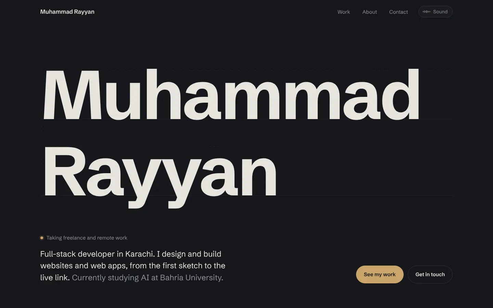
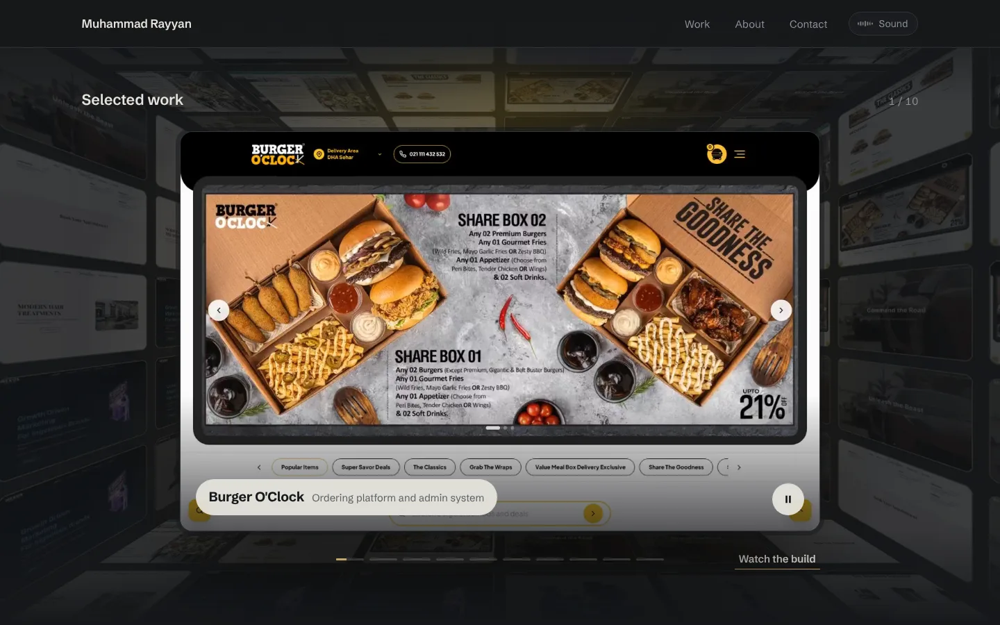
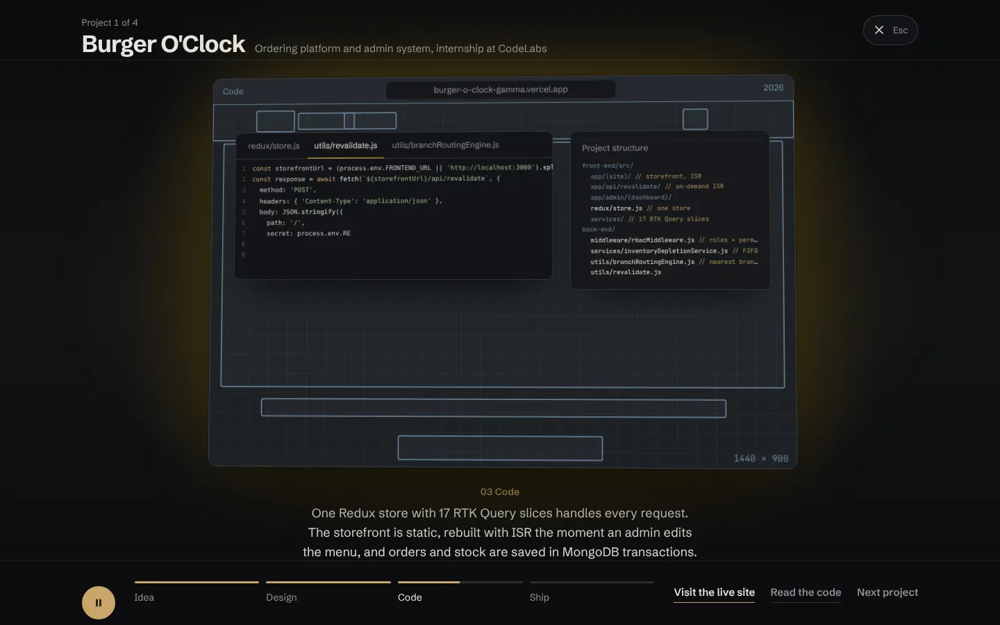

# Muhammad Rayyan, portfolio

My portfolio, where each project plays as a short film from the first sketch to the live site.

**Live:** [rayyan-portfolio-xi.vercel.app](https://rayyan-portfolio-xi.vercel.app)



## What's on it

- **Selected work.** A showreel of ten projects. Each slide plays a recording of the real site, flying through a pre-rendered tunnel.
- **Watch the build.** Four projects open a full-screen window that plays their build in four chapters: the brief, the design, the real code (typed out file by file in editor tabs), then the live site. Burger O'Clock goes on to a tour of its admin panel.
- **How I got here.** My story as one paragraph that lights up as you scroll, with small live pieces set into the sentences: clips, a clock, a call waveform.
- **Background music.** An original lofi loop, composed in code and synthesized live with the Web Audio API. It's silent until someone presses Sound, and nothing loads before then.
- **The footer.** My name drawn as hatching, the way a section is drawn on a blueprint, and a cursor that lights up the ruled lines around it.




## Built with

- Next.js 15 (App Router) and React 19, TypeScript
- GSAP with ScrollTrigger, and Lenis for smooth scrolling
- Web Audio API for the music and visualizer
- Plain CSS: no UI library, one stylesheet with design tokens

## Performance

Lighthouse scores 99 for performance. Things that keep it fast:

- Animations only touch `transform` and `opacity`, so the browser composites them on the GPU without repainting.
- The reel's tunnel is a single pre-rendered image, not live 3D.
- Clips load only for the slide on screen and the next one.
- Canvas effects redraw only while something moves, and only the area that changed.
- Reduced-motion users get a calm version of every section.

## Structure

```
app/
  layout.tsx        fonts, metadata
  page.tsx          the sections, in order
  globals.css       design tokens and all styles
components/
  data.ts           every project, the story and contact details
  Hero.tsx          the name drawn on a drafting grid
  Reel.tsx          the showreel
  Theater.tsx       the "Watch the build" window
  ProjectIndex.tsx  every project in one list
  About.tsx         the story paragraph
  Finale.tsx        the footer, with FinaleField.tsx for the cursor field
  Sound.tsx         the music control; the music itself is in lofi.ts
public/
  reel/             recorded clips and posters
  work/             screenshots used in the build window
```

## Run it

```bash
npm install
npm run dev
```

Then open [localhost:3000](http://localhost:3000).

## Contact

[rayyanhabib1@gmail.com](mailto:rayyanhabib1@gmail.com) | [LinkedIn](https://www.linkedin.com/in/muhammad-rayyandev)
